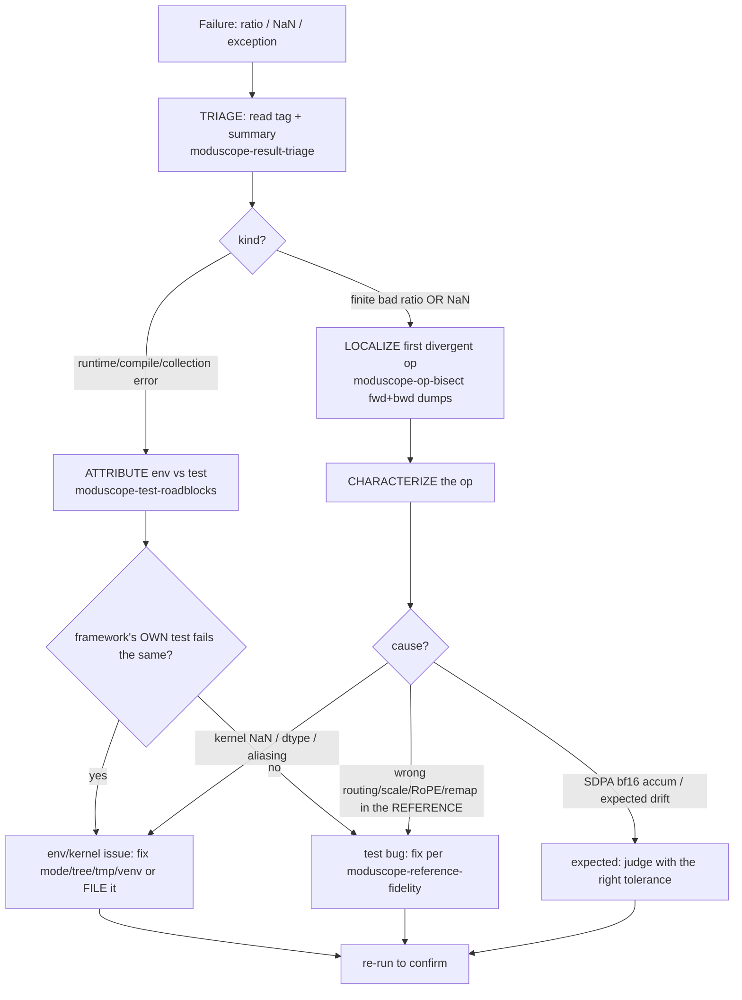

# ModuScope Accuracy Debug — root-cause any divergence

## Overview

One skill to load when a ModuScope component/module test **fails, ratios badly, or NaNs**. It runs
a four-stage loop — **triage → attribute → localize → characterize/conclude** — and delegates the
heavy machinery to the detailed skills (`op-bisect`, `test-roadblocks`, `result-triage`,
`reference-fidelity`, `run-test`). The goal: turn "the test failed" into a precise verdict —
*which op, and whether it's a real kernel bug, expected bf16 drift, an env/setup issue, or a bug in
the test's own reference wrapper* — with cited evidence, never a guess.

## Usage

Use this when a `moduscope` run has ANY failure or you must root-cause a divergence: "debug
accuracy", "why did test_NN fail", "root cause the ratio / NaN", "which op is wrong", "bisect the
divergence", a `[FAIL-targetNaN]`, a ratio ≥ tolerance, or a collection/runtime/compile error. This
is the entry point; it pulls in the specific skills per stage below.

## Core Concepts

Every test asserts `ratio = ||target_bf16 − ref_fp32|| / ||ref_bf16 − ref_fp32|| < tol` via
`check_3tensor_result`, tagged `[PASS]/[FAIL]/[PASS-NaN]/[FAIL-targetNaN]/[PASS-zero]/[FAIL-zero]/
[PASS-near-zero]`. The tag + whether the failure is an *exception* (runtime) vs a *finite bad ratio*
vs a *NaN* is the first fork of the debug loop.

## The debug loop



## Stages (what to do + which skill)

1. **TRIAGE** (`moduscope-result-triage`). Read `summary.txt` / the `[TAG]` line. Classify: finite
   ratio ≥ tol (drift/real bug), `[FAIL-targetNaN]` (Neuron produced NaN/Inf), `[FAIL-zero]`, or an
   EXCEPTION (import/collect/compile/runtime — not a ratio at all). For deepseek
   `score_before_experts=False`, remember the forward can be insensitive — trust weight grads.
2. **ATTRIBUTE env vs test** (`moduscope-test-roadblocks`), especially for exceptions and NaNs.
   Check the usual causes: wrong **compile mode** (attn/block EAGER, experts/MoE COMPILED —
   `moduscope-run-test`); **stale target tree** (use the current one, e.g. cr_validation); `/tmp`
   perms (`sudo chmod -R 777 /tmp`); wrong venv (not `<incompatible-venv>`); missing **CPU op-patch**
   (`torch.histc`/`torch.bmm`); **repo version skew** (`skip_clear`/helper missing). **Confirm by
   running the FRAMEWORK's own `test_NN`** in the same mode/node: if it fails identically → env/kernel
   (not your test); if it passes → the generated test differs (a test bug).
3. **LOCALIZE the op** (`moduscope-op-bisect`) for a genuine numerical divergence — the core method
   is **torch.save after every line/op on BOTH the CPU reference module and the Neuron target
   module, then compare in execution order**. Three capture layers (all hardware-proven): eager →
   `register_all_hooks(model)` or line-level `dump()`; compiled `backend="neuron"` → the module
   **RETURNS** its intermediates (extra outputs) + a dummy fwd/bwd for grads (hooks can't fire
   mid-graph); NKI → `nl.device_print("tag", tile)` **invoked via `wrap_nki` (NOT `@nki.jit`/
   `@nki_op` — those hit `torch_neuronx.pyhlo`)** with `NEURON_RT_DEBUG_OUTPUT_DIR` set, then
   `instrument_dump.load_device_print(dir, tag)` reads the tile from the runtime's dump files. Run
   CPU-ref and Neuron-tgt with separate `OPDUMP_DIR`s, then `bisect_compare.py` reports the FIRST
   divergent stage (fwd for output divergence, bwd for a grad NaN). Set `--threshold` above the
   bf16/Neuron drift floor (~1e-2) or use the 3-tensor ratio. Narrow coarse module hits to line level.
4. **CHARACTERIZE & CONCLUDE.** Map the localized op to a cause. **Backward-grad fingerprints** tell
   you which cause on sight: a grad stuck at a **flat floor** = matmul-input limit (RC-3); one that
   **grows as you turn up input scale** = softmax-backward cancellation (RC-4); a grad that
   **explodes while its forward is bit-perfect** = RoPE/autograd (RC-5); a grad that comes back
   **exactly zero** = dropped tile (RC-7). **Seq-length probe** to tell fixable from fundamental: run
   the same test at two sequence lengths — error **grows with length** = accumulation (fixable, the
   RC-2 fp32-accumulator win); **flat** = a floor (RC-3), stop polishing and relax the threshold.
   Then:
   - **SDPA bf16 accumulator drift** (attention fwd, tiny-activation dists) → expected; judge with
     the intended tolerance (note: `SDPA_FWD_TOLERANCE_RATIO=3.0` is wired but NOT applied, so test_13
     forward drift is judged by eye against the 1.1 line, not enforced by policy — a known to-do).
   - **complex-RoPE `.conj()` 50–90× bwd** → wrong venv.
   - **kernel NaN / `dma_copy` dtype / `nki_*_fwd` aliasing / Stack-OOM** → env/kernel (file to
     Neuron; often fixed by compiled mode + current tree; large models need higher TP).
   - **wrong routing / PRE-vs-POST score / RoPE / weight remap** localized to the REFERENCE wrapper
     → a test bug — fix per `moduscope-reference-fidelity` (derive from source).

## Quick failure→first-move map

| symptom | first move |
|---|---|
| `[FAIL-targetNaN]` in a **backward** grad | op-bisect `--phase bwd`; likely Neuron kernel NaN (attention bwd) → attribute, file |
| finite ratio ~2–3× on **attention forward** | expected SDPA bf16 accum; check tolerance before calling it a bug |
| ratio ~50–90× across **many bwd** grads | wrong venv (complex conj) — fix venv, don't debug ops |
| `nki_*_fwd ... must not alias` / `dma_copy bf16 vs f32` / `Stack OOM` | env/kernel: compiled mode + current tree; higher TP for big models; file |
| `Permission denied /tmp/neuron_backend` | `sudo chmod -R 777 /tmp` |
| forward PASSES but **weight grads** fail on deepseek | routing-path bug (score_before_experts=False hides it in fwd) — op-bisect the bwd |
| import/collect error (`skip_clear`, helper missing) | repo version skew — align conftest_base / current tree |

## Common mistakes

- **Debugging ops before attributing env.** Always run the framework's own `test_NN` first — most
  "failures" are wrong mode / stale tree / `/tmp` / venv, not numerics.
- **Chasing every differing op.** Only the FIRST divergent op is the origin (op-bisect orders it).
- **Calling expected bf16 drift a bug** (or a real NaN "just drift"). The tag distinguishes them:
  finite ratio = drift/real; non-finite = `[FAIL-targetNaN]` = kernel blew up.
- **Fixing the kernel when it's the reference.** If the divergence localizes to a step the REFERENCE
  wrapper does differently than model source, it's a test bug — fix the wrapper, not the kernel.

## How to test this skill

The localization engine has a deterministic self-test (fake 10-op cpu vs neuron, one op changed):
```bash
python ../moduscope-op-bisect/scripts/selftest_bisect.py   # expects: SELFTEST OK — origin = op05
```
And the routing coverage — this skill must name each stage's tool:
```bash
for s in result-triage test-roadblocks op-bisect reference-fidelity run-test; do
  grep -q "moduscope-$s" SKILL.md && echo "OK $s" || echo "MISSING $s"; done
```
Success: the self-test prints `SELFTEST OK — origin = op05` and all five tools are referenced.
