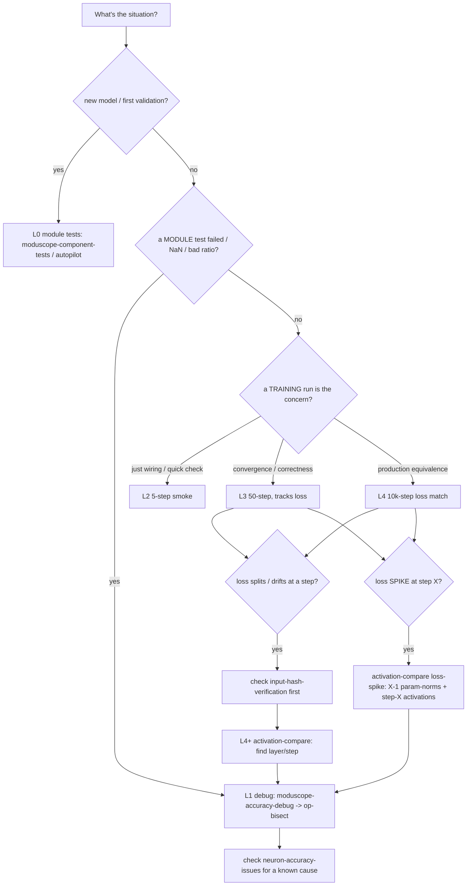

# ModuScope Accuracy Levels — pick the right test/debug level

## Overview

Accuracy validation and debugging happen at several **levels**, cheapest and most granular first.
This skill is the router: from what you're doing (onboarding a model, a failing module, a diverging
training run, a loss split at step N) it picks the level and names the exact skill to load. Prefer
the **lowest level that answers the question** — module tests before 10k runs, per-op localization
before whole-model activation sweeps.

## Usage

Load this when asked "how do I validate accuracy", "which test/level should I run", "where do I
start debugging this divergence", "is a quick check enough or do I need a full run", or when a
result is ambiguous about scope. It doesn't run tests itself — it selects the level and delegates.

## Core Concepts

- **Level = how deep, not what model.** The level (module → op → 5-step → 50-step → 10k → activation
  compare) is the granularity of the check; the model *family* (dense vs MoE) only picks which run
  skill you use at L2–L4.
- **Lowest level that answers the question wins.** A module test (L0) or per-op bisect (L1) resolves
  most kernel-correctness questions in minutes; reserve 10k runs (L4) for convergence equivalence.
- **Coarse-to-fine for whole-model symptoms.** L4/L3 symptom → L4+ activation-compare (which
  layer/step) → L1 op-bisect (which op) → `neuron-accuracy-issues` (which known cause).
- **One metric family throughout.** The component ratio (`‖tgt_bf16−ref_fp32‖/‖ref_bf16−ref_fp32‖ <
  1.1`) at L0/L1 and FrobRatio/CosSim per layer/step at L4+ are the same idea at different scopes.

## The level ladder

| Level | Scope | Speed | Use when | Skill(s) to load | Pass / signal |
|---|---|---|---|---|---|
| **L0 Module / component** | one module (norm, rope, linear, FFN, attn, block, router, experts, MoE) CPU/GPU ref vs Neuron | minutes | onboarding a model; first line of defense; any per-module question | `moduscope-component-tests`, `moduscope-newmodel`/`moduscope-autopilot`, plus the suite (`model-profile`, `register-model`, `statedict-mapping`, `reference-fidelity`, `run-test`, `gpu-baselines`, `trn-compare`, `dist-sweep`, `node-select`, `parallel-orchestration`, `result-triage`, `test-roadblocks`, `env-bootstrap`, `add-test-module`) | ratio < 1.1 fwd + all grads |
| **L1 Op / NKI debug** | inside a failing module — the exact op/line | minutes–hours | a module FAILS, ratios badly, or NaNs | `moduscope-accuracy-debug` (front door) → `moduscope-op-bisect` (per-op fwd/bwd dumps; eager / compiled-returns / NKI device_print) | first divergent op localized |
| **L2 5-step small-model smoke** | a small real model, ~5 steps | ~minutes | fast integration catch (wiring, dtype, data) before committing a long run | dense: `qwen3-mel-runs`; MoE: `moe-gpu-trn-accuracy`/`qwen3-gpu-trn-accuracy`; e2e: `titan-accuracy` — run with a tiny step budget | no crash; step-0/step-N loss + hash sane |
| **L3 50-step full-model** | full model, ~50 steps | ~tens of min | medium correctness/convergence; loss tracks | same run skills, larger step budget; `input-hash-verification` for 1:1 data | loss curves track within noise |
| **L4 10k-step long run** | full model, 10k steps, loss-curve match | hours–days | production-grade convergence equivalence | `apples-10k-trn-vs-gpu`, `qwen3-mel-runs` (10k), `multinode-trn-run` for multi-node | input hashes match; per-layer ratio <1.10; cosine >0.999 (weights >0.9999); loss 1–2%; forced-routing KL ~1e-3; Llama3-8B=1.0000 |
| **L4+ Activation compare** | per-layer activations/weights across steps | overlay on L3/L4 | a long run drifts / loss splits at step N — localize the layer & step | `activation-compare` → then L1 `op-bisect` on the drifting layer | first drifting (layer, step) found |

Cross-cutting (load alongside any level):
- **Large-model acceptance without fp32** → `large-model-accuracy-bounds` (GPU bf16-ULP perturbation
  envelope + grad-norm difference trajectory) — the L4 accept/reject signal when an fp32 reference
  is infeasible.
- **Known causes / precision / summary** → `neuron-accuracy-issues` (the 9-bug catalog, precision RCs, CRs, the accuracy brief).
- **Cluster / env** → `cluster-ops`, `env-bootstrap`, `install-docker-at-mel`.

Scope note: this ladder is **training-side** accuracy. Inference/decode accuracy is a separate,
not-yet-covered problem (a flipped decode token breaks a fixed reference); downstream eval-metric
parity is long-term.

## How to auto-select (decision tree)



For a **loss spike at step X** specifically: use `activation-compare`'s two-pronged loss-spike
workflow — compare **per-parameter norms of the X-1 checkpoint** on both platforms (did a weight
norm already drift?) AND the **step-X activations** (which layer first deviates?) — then op-bisect
the implicated layer and check `neuron-accuracy-issues` (a same-step spike on BOTH chips is usually
optimizer/warmup noise, not a bug).

Rules of thumb:
- **Start as low as possible.** A module test (L0) or op-bisect (L1) answers most "is the kernel
  right?" questions in minutes; don't launch a 10k run to find a per-op bug.
- **Dense vs MoE picks the run skill**, not the level: dense → `qwen3-mel-runs`/`titan-accuracy`;
  MoE → `moe-gpu-trn-accuracy`/`qwen3-gpu-trn-accuracy`.
- **A whole-model symptom → go coarse-to-fine:** L4/L3 (symptom) → L4+ activation-compare (which
  layer/step) → L1 op-bisect (which op) → `neuron-accuracy-issues` (which known cause).
- **Always rule out data desync** (`input-hash-verification`) before calling a step-N split a
  numeric bug.

## Common mistakes

- **Jumping to a 10k run to debug a kernel** — use L0/L1 first (minutes vs days).
- **Debugging ops before localizing the layer** in a full-model drift — use L4+ activation-compare
  to narrow to a layer/step, THEN op-bisect.
- **Ignoring the known-issues catalog** — many divergences are already understood in
  `neuron-accuracy-issues` (cite the CR instead of re-debugging).
- **Confusing level with model family** — the level is *how deep*; the family (dense/MoE) only
  picks which run skill.

## How to test this skill

The router must name a skill for every level and the decision paths must resolve:
```bash
for s in moduscope-component-tests moduscope-accuracy-debug moduscope-op-bisect \
         qwen3-mel-runs moe-gpu-trn-accuracy apples-10k-trn-vs-gpu activation-compare \
         neuron-accuracy-issues input-hash-verification titan-accuracy; do
  grep -q "$s" SKILL.md && echo "OK $s" || echo "MISSING $s"; done
```
Success: every level's skill is referenced (all `OK`).
