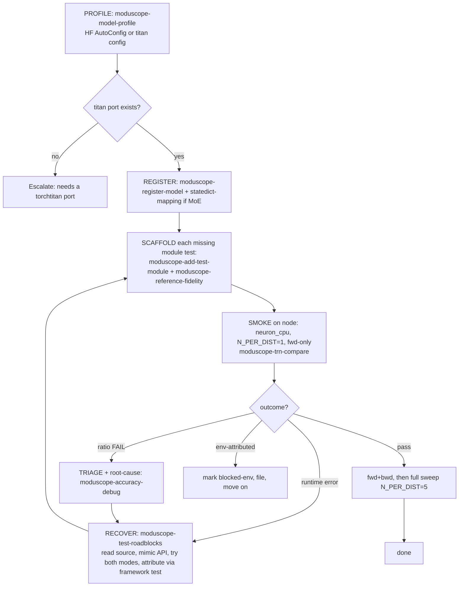

# ModuScope Autopilot — near-zero-touch model onboarding & test

## Overview

One driver that takes a model (HF id or titan name) + a node and produces RUNNING, verified
component tests with no per-step human intervention. It composes the 14 building-block skills
into a self-healing state machine: every failure is a transition (recover → retry), not a stop.
It stops only when each applicable module test PASSES, or a failure is provably ENVIRONMENTAL
(the framework's own test fails identically), or a bounded iteration cap is hit — then it
escalates with a precise diagnosis. `moduscope-newmodel` is the routing map; this skill is the
automatic loop over it.

## Usage

Use this skill when asked to onboard/test a model end-to-end with minimal touch: "add tests for
`<HF model>`", "onboard `<model>`", "make the tests automatically", "zero-touch / autopilot", or
to drive the whole GPU→S3→TRN campaign hands-off. For a single manual step, use the specific
mini-skill instead.

## Core Concepts

### Inputs & the only human-touch points ("almost zero")

- **MODEL**: HF id (e.g. `Qwen/Qwen3-30B-A3B`, `deepseek-ai/DeepSeek-V3`) OR a registered titan
  name (`deepseekv3_16b`).
- **NODE**: a Neuron/TRN node (preferred — `neuron_cpu` is the single-node smoke, no S3/GPU) or a
  GPU node for `gpu_save`.
- Human touches only: providing fresh AWS creds (S3 cross-cluster only), node allocation, and the
  final accept of any ENV-attributed blockers. Everything between is automatic.

### The self-healing loop (per applicable module)



### Stop / escalation rules (bounded, no infinite loops)

A module is FINALIZED when one of:
1. **PASS** — fwd+bwd within tolerance → run the full sweep, mark ✅.
2. **BLOCKED-ENV** — recovery's attribution step (run the framework's OWN `test_NN`) shows it fails
   identically → it is a kernel/venv/branch issue, not the generated test → record diagnosis + the
   `attn_backend="sdpa"`-style reduced-coverage fallback result if any, file, move on.
3. **ESCALATE** — `MAX_RECOVERY_ITERS` (default 3) reached without PASS or ENV-attribution → stop and
   emit a precise state dump (last error, source lines read, hypotheses tried). Never loop forever.

### HF vs titan entry

- **titan name** → `moduscope-model-profile` directly.
- **HF id** → `moduscope-model-profile` in HF mode: read `transformers.AutoConfig`, classify
  architecture (MoE? attention kind? experts/top_k/q_lora_rank/sliding_window), and MAP to the
  nearest titan `model_name`+`flavor` (see the HF→titan table in `moduscope-model-profile`). If no
  titan port exists for that architecture, ESCALATE (porting torchtitan is out of scope).

### Parallelization (scales with modules & nodes)

Independent modules (attention, grouped_experts, moe, transformer_block) are scaffolded and smoked
in PARALLEL — subagent fan-out, and on a multi-core Neuron node pin each to its own
`NEURON_RT_VISIBLE_CORES`. Recovery round-trips are per-module so one stuck module never blocks the
rest. Use `moduscope-parallel-orchestration` for multi-node fan-out.

## Workflow (concrete, hands-off)

1. **Profile** → `moduscope-model-profile` (HF or titan). Emits group (dense/moe), attention kind,
   MoE params, seq_len, and `applicable_tests`. HF → titan mapping happens here.
2. **Register** (if not already) → `moduscope-register-model` (MODEL_REGISTRY + DEVICE_CLASS_MAP);
   MoE also → `moduscope-statedict-mapping` (verify ref→NKI layout with `verify_mapping.py`).
3. **Scaffold** the `applicable_tests` that don't exist → `moduscope-add-test-module` applying
   `moduscope-reference-fidelity` (derive every wrapper step from source; include CPU op
   monkeypatches for MoE/block). Fan out one subagent per module.
4. **Env** → `moduscope-env-bootstrap` on the node (prefer `TEST_MODE=neuron_cpu`).
5. **Smoke** each module → `moduscope-trn-compare` `MODE=neuron_cpu N_PER_DIST=1` fwd-only on a free
   core (`moduscope-node-select`). Watch the log.
6. **On outcome** (the round-trip):
   - py_compile/collection/runtime error → `moduscope-test-roadblocks`: read the failing op's full
     source, fix the contract (CPU patch, Config idiom, version-skew helper), OR try the other
     `TORCH_COMPILE` mode, OR run the framework's own `test_NN` to attribute env-vs-test. Re-scaffold
     or patch, go to step 5.
   - ratio FAIL → `moduscope-result-triage` to classify (real bug vs expected drift) → recover or accept.
   - PASS → re-run fwd+bwd, then full sweep (`N_PER_DIST=5`, `moduscope-dist-sweep`).
7. **Report**: per-module ✅PASS / ⚠️BLOCKED-ENV(+diagnosis) / ❌ESCALATE, with ratios.

## Quick reference

```bash
# autopilot inputs (env)
MODEL=<hf-id-or-titan-name>     NODE=<neuron-node>     MAX_RECOVERY_ITERS=3
# smoke step the loop runs first (per module), via moduscope-trn-compare:
NODE=$NODE MODEL_CONFIG=<titan-name> TESTS=test_15_moe.py N_PER_DIST=1 MODE=neuron_cpu \
  bash <skills>/moduscope-trn-compare/scripts/run_trn_neuron.sh   # then RUN_BWD=1, then full sweep
```

Known-good baselines to anchor attribution: `test_14`/`test_15` PASS fwd+bwd on Trainium; `test_13`/
`test_16` are BLOCKED-ENV (NKI attention `nki_attn_fwd` kernel bug — fails the framework's own tests
too; `attn_backend="sdpa"` fallback passes the fwd). See `moduscope-newmodel` hardware-status.

## Common mistakes

- **Looping forever on an env failure.** Always run the framework's own `test_NN` to attribute; if it
  fails identically, mark BLOCKED-ENV and move on — do not regenerate the test repeatedly.
- **Skipping the neuron_cpu smoke.** Going straight to the full GPU→S3→TRN sweep wastes allocations;
  smoke one dist fwd-only first.
- **Serial module-by-module.** Independent modules parallelize; fan out.
- **Assuming an HF model has a titan port.** If profiling can't map the architecture, ESCALATE — do
  not invent a mapping.

## How to test this skill

```bash
<skill-builder-validator> \
  $SKILLS/moduscope-autopilot/SKILL.md
# routing coverage: the loop must name every skill it orchestrates
for s in model-profile register-model statedict-mapping add-test-module reference-fidelity \
         env-bootstrap node-select trn-compare result-triage test-roadblocks dist-sweep \
         parallel-orchestration newmodel; do
  grep -q "moduscope-$s" $SKILLS/moduscope-autopilot/SKILL.md \
    && echo "OK $s" || echo "MISSING $s"; done
```

Success: validator passes and every line prints `OK`.
