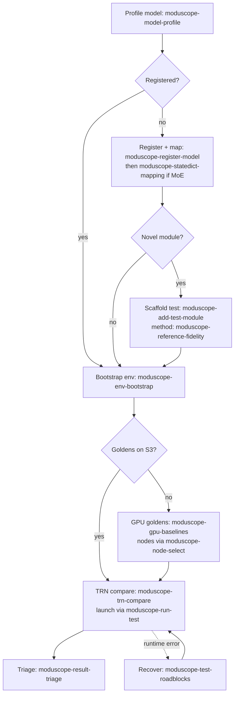

# ModuScope New-Model Onboarding & Test Orchestrator

## Overview

Single entry skill for two jobs: (1) **onboard** a new torchtitan model into the ModuScope
BF16 component-equivalence framework, and (2) **run** all applicable component tests
cross-cluster — GPU CUDA fp32+bf16 reference vs TRN Neuron bf16 target. This skill is a
router: it decides *which* of 12 mini-skills to invoke in *what order* and on *which branch*.
It does not duplicate mini-skill internals. Load it first; follow the WORKFLOW; delegate each
step.

> For **hands-off, near-zero-touch** onboarding (including HuggingFace models) with automatic
> round-trips / self-healing, use **`moduscope-autopilot`** — it drives this same routing as a
> bounded self-healing loop (profile → scaffold → smoke → recover → repeat). This skill is the
> map; autopilot is the automatic driver over it.

## Usage

Load this skill when the user asks to:

- "Onboard a new model into ModuScope component tests" / "add `<model>` to ModuScope"
- "Run ModuScope component tests for `<model>`" (model may or may not be registered yet)
- "Set up module equivalence tests for `<model>`" / start a GPU->S3->TRN campaign
- Resume a partially-onboarded model (registry done, goldens missing, etc.)

If the request is about an already-registered model and infra exists, you MAY skip the
onboarding stages and jump straight to the run stages (see WORKFLOW decision branches).

## Core Concepts

### The cross-cluster ratio model (what every test asserts)

Each test computes, per tensor (fwd output, each weight grad, input grad):

```
ratio = ||target_bf16 - ref_fp32||_F / ||ref_bf16 - ref_fp32||_F     PASS if ratio < 1.1
```

A pass means Neuron's bf16 drift from the fp32 reference is within ~10% of CUDA's own bf16
drift. NaN-safe / zero-denominator verdicts (`[PASS-NaN]`, `[FAIL-targetNaN]`, `[PASS-zero]`,
`[FAIL-zero]`, `[PASS-near-zero]`) are handled inside `check_3tensor_result`
(`shared/conftest_base.py`). Tolerance overrides: `BWD_TOLERANCE_RATIO` (1.1),
`QK_NORM_BWD_TOLERANCE_RATIO` (1.2), `SDPA_FWD_TOLERANCE_RATIO` (3.0 — Neuron SDPA bf16
accumulator drift). Triage details live in **moduscope-result-triage**. On ANY failure / bad ratio /
NaN / runtime error, load **moduscope-accuracy-debug** — the single debug front-door that runs
triage → attribute (env vs test) → localize the op (op-bisect) → conclude, orchestrating the detailed
debug skills.

### The onboarding-then-run pipeline

```
PROFILE -> REGISTER -> ENV -> [MAP statedict] -> NODES
        -> GPU goldens (gpu_save -> S3) -> TRN compare (neuron) -> TRIAGE
```

S3 is the only bridge between clusters (`$SHARED/` is NOT cross-cluster). GPU writes
goldens to `s3://<bucket>/titan/modules/moe/{model}/{module}/{dist}/`; TRN downloads them.
TEST_MODE drives device routing: `gpu_save` (capture, no compare, early-return after upload),
`neuron` (download S3 ref, build neuron target, compare). The full TEST_MODE table and env
matrix are owned by **moduscope-env-bootstrap** and **moduscope-run-test**.

### Dense vs MoE test inventory

- **Dense** (group=`dense`): tests `test_00`..`test_07` (RMSNorm, embedding, RoPE, linear,
  FeedForward, GQAttention, block, output head). `test_04` is the MLP test.
- **MoE** (group=`moe`): tests `test_08` (router), `test_13` (attention MLA/GQA/MHA),
  `test_14` (grouped experts), `test_15` (full MoE — the MLP-equivalent superset), `test_16`
  (full block). `test_04` skips. Roles in `DEVICE_CLASS_MAP`: attention, grouped_experts,
  moe, transformer_block.

The model's `group` (from its `MODEL_REGISTRY` entry) selects the inventory.
**moduscope-model-profile** determines group, attention kind (MLA/GQA/MHA), MoE-vs-dense, and
`seq_len` constraints (NKI MoE BLOCK_SIZE=512 requires `(T//512)%16==0` -> deepseek/qwen3_30b
use seq_len=8192).

## The 14 mini-skills (router targets)

| # | Mini-skill | Owns |
|---|---|---|
| 1 | `moduscope-model-profile` | introspect torchtitan config -> profile: group, MLA/GQA/MHA, MoE/dense, seq_len, which tests apply |
| 2 | `moduscope-register-model` | add `MODEL_REGISTRY` (conftest.py) + `DEVICE_CLASS_MAP` (conftest_base.py) entries |
| 3 | `moduscope-env-bootstrap` | venvs, PYTHONPATH, REF_PATH/TARGET_PATH, creds, `pytest_clean.ini`, TEST_MODE matrix |
| 4 | `moduscope-statedict-mapping` | ref->NKI weight mapping for MoE (test_14/test_15 `_map_*`) |
| 5 | `moduscope-node-select` | find free GPU (the GPU cluster) / TRN (the TRN cluster) nodes |
| 6 | `moduscope-gpu-baselines` | `gpu_save` -> S3 goldens |
| 7 | `moduscope-trn-compare` | `neuron` mode compare on TRN |
| 8 | `moduscope-run-test` | per-test launch knowledge & quirks (env-driven invocation) |
| 9 | `moduscope-dist-sweep` | `COMPONENT_TEST_N_PER_DIST` control; dump dist params |
| 10 | `moduscope-parallel-orchestration` | multi-node parallel launch + monitor |
| 11 | `moduscope-result-triage` | parse `report.json`, classify failures, emit verdict |
| 12 | `moduscope-add-test-module` | scaffold a new `test_NN_*.py` for a novel module |
| 13 | `moduscope-reference-fidelity` | METHOD used by register/map/scaffold/run: build a 1:1 faithful reference wrapper by reading model source (derive, never invent) |
| 14 | `moduscope-test-roadblocks` | RECOVERY playbook for run/triage: runtime errors (CPU op gaps, version skew, NKI Config idiom, NKI kernel/compile errors) — read source, mimic API, try both modes, attribute via framework baseline |

## Workflow

Invoke mini-skills in this order. Branch as the diamonds indicate. Each node names the
mini-skill that owns the step; load that skill, do the step, return here for the next.



Cross-cutting helpers (used inside the nodes above, not separate steps):
- **moduscope-dist-sweep** sets `COMPONENT_TEST_N_PER_DIST` (1 = 7-cfg smoke; 5 = 35-cfg full)
  for BOTH the GPU goldens step and the TRN compare step. Use smoke first, then full.
- **moduscope-node-select** is called by both the GPU goldens and TRN compare steps to pick
  free nodes.
- **moduscope-parallel-orchestration** wraps the GPU and/or TRN steps when running multiple
  tests across multiple nodes at once.
- **moduscope-reference-fidelity** is the METHOD every authoring/scaffolding step uses to build a
  reference wrapper that is 1:1 with the target (read source -> mimic the real API contract -> never
  invent). Load it before writing any routing/scaling/RoPE/remap/CPU-op-patch logic.
- **moduscope-test-roadblocks** is the RECOVERY playbook for the run/triage steps: when a test
  py_compiles but errors on the node (CPU op gap, repo-version skew, NKI Config idiom, NKI
  kernel/compile error), it gives the procedure (read source -> mimic -> try the other mode ->
  attribute via the framework's own test) plus a catalog of known fixes.

### Stage -> mini-skill -> output

| Stage | Mini-skill(s) | Produces |
|---|---|---|
| 1. Profile | moduscope-model-profile | model profile: group (dense/moe), attention kind, seq_len, applicable test list |
| 2. Register | moduscope-register-model | `MODEL_REGISTRY` + `DEVICE_CLASS_MAP` entries; `pytest --collect-only` succeeds |
| 2b. Map weights (MoE only) | moduscope-statedict-mapping | ref->NKI `_map_*` weight mapping verified for test_14/test_15 |
| 2c. New module (if needed) | moduscope-add-test-module | new `test_NN_*.py` scaffold that collects |
| 3. Env | moduscope-env-bootstrap | venv activated, PYTHONPATH/REF_PATH/TARGET_PATH set, creds, `pytest_clean.ini` |
| 4. Pick nodes | moduscope-node-select | free GPU node (the GPU cluster) and/or TRN node (the TRN cluster) |
| 5. GPU goldens | moduscope-gpu-baselines (+ dist-sweep, parallel-orchestration) | S3 goldens under `s3://<bucket>/titan/modules/moe/{model}/...` |
| 6. TRN compare | moduscope-trn-compare + moduscope-run-test (+ dist-sweep, parallel) | `report.json` / `report.html` under `logs/{model}/{device}/` |
| 7. Triage | moduscope-result-triage | per-tensor verdicts, failure classification, `THRESHOLD_RESULT: PASS|FAIL` |

### Decision branches (explicit)

- **Dense vs MoE**: from the profile's `group`. Dense -> run `test_00`..`test_07` (MLP =
  `test_04`). MoE -> run `test_08`,`test_13`..`test_16` (`test_04` auto-skips; `test_15` is
  the MLP-equivalent superset). Only MoE needs the statedict-mapping step (2b).
- **Already registered?** If `MODEL_REGISTRY` + `DEVICE_CLASS_MAP` already have the model and
  `pytest --collect-only` works, skip stages 2/2b and go to Env.
- **Goldens already on S3?** If `aws s3 ls s3://<bucket>/titan/modules/moe/{model}/` shows
  the needed `{module}/{dist}/` artifacts for the target `N_PER_DIST`, **skip gpu_save** and
  go straight to TRN compare. Otherwise run the GPU goldens step first.
- **Novel module (no existing test_NN)?** If profiling surfaces a module with no matching
  test file, branch to **moduscope-add-test-module** before env/run.
- **Smoke vs full sweep**: always run `N_PER_DIST=1` smoke (per **moduscope-dist-sweep**)
  before committing to the `N_PER_DIST=5` full sweep on both clusters.
- **Runtime error on the node (not a ratio FAIL)?** Load **moduscope-test-roadblocks**: try BOTH
  eager and compiled (`TORCH_COMPILE=0/1`) — some NKI kernels fail in only one mode — and ALWAYS run
  the framework's own `test_NN` to attribute env/kernel vs a generated-test bug before "fixing" the test.
- **Single-node smoke (recommended first):** `TEST_MODE=neuron_cpu` builds the CPU reference locally and
  runs the target on Neuron — no S3, no GPU cluster. Use it for the fastest real-NKI signal before the
  full GPU->S3->TRN flow.

## Hardware-verified status (deepseekv3_16b, neuron_cpu)

Verified on a live Trainium node (treat as known-good baselines):
- ✅ `deepseekv3_16b`: `test_14` grouped_experts + `test_15` moe — PASS fwd+bwd. `test_13`/`test_16`
  blocked by the MLA `nki_attn_fwd` aliasing kernel bug (fails the framework's own tests too).
- ✅ `qwen3_30b_a3b`: ALL of `test_13` attention (EAGER), `test_14` grouped_experts + `test_15` moe
  (COMPILED) — PASS fwd+bwd, against the CURRENT target tree (`cr_validation`). REQUIRES the per-test
  mode (attention/block EAGER, experts/MoE COMPILED `TORCH_COMPILE=1`) AND a current `TARGET_PATH` —
  older trees (e.g. `deepseek_v3_optimized`) have a qwen3 MoE weight-grad kernel bug (eager
  `nki_moe_fwd` aliasing / compiled `dma_copy bf16->f32`).
- ⚠️ `qwen3_235b`: full tp4 per-core is too big for one core, but ✅ `test_15` MoE PASSES fwd+bwd at
  **tp16** (per-core hidden 96), COMPILED + current tree — raise TP on the REAL config to fit a large
  MoE on one core (do NOT hand-craft a singlecore proxy — it gives wrong numerics).
- The `attn_backend="sdpa"` reduced-coverage fallback (moduscope-test-roadblocks;
  a test exposes it, e.g. via an env knob)
  passes the attention forward; its backward hits a separate Neuron SDPA-NaN. Both are environmental
  (file with the Neuron team) — NOT test/skill defects.

## Quick Reference

- Source repo: `$WORKSPACE/<neuron-env>-stage/ModuScope/test/component_tests_torchtitan/`
  (`bf16/tests/` has tests + `conftest.py` + `README.md`; `shared/` has `conftest_base.py`).
- Registry: `MODEL_REGISTRY` (`bf16/tests/conftest.py`), `DEVICE_CLASS_MAP`
  (`shared/conftest_base.py`).
- S3 bridge: `s3://<bucket>/titan/modules/moe/{model}/{module}/{dist}/`.
- TEST_MODE: `gpu_save` (capture) -> S3 -> `neuron` (compare). Full matrix in
  moduscope-env-bootstrap.
- Fastest single-node smoke: `TEST_MODE=neuron_cpu` (CPU ref + Neuron target, no S3/GPU).
- Always pytest with `-c $SHARED/pytest_clean.ini`.
- Production TRN venv: `$SHARED/<neuron-env>/private-torch-neuronx/.venv` (NOT
  `<incompatible-venv>`). Detail owned by moduscope-env-bootstrap / moduscope-trn-compare.

## Common Mistakes

- **Skipping profiling.** Running tests before knowing group/seq_len wastes a cluster
  allocation. Always run moduscope-model-profile first.
- **Running gpu_save when goldens already exist.** Check S3 first (decision branch above).
- **Re-implementing a mini-skill here.** This skill routes only. If you need the *how* of a
  step, load that mini-skill — do not inline its commands.
- **Wrong test inventory for the group.** Don't run `test_14`/`test_15` for a dense model or
  `test_04` for MoE; let the profile's `group` pick the list.

## How to test this skill

Structural + routing-coverage check (no cluster calls):

```bash
# 1. Validator passes
<skill-builder-validator> \
  $SKILLS/moduscope-newmodel/SKILL.md

# 2. All 12 mini-skills are referenced by name in the routing tables
for s in model-profile register-model env-bootstrap statedict-mapping node-select \
         gpu-baselines trn-compare run-test dist-sweep parallel-orchestration \
         result-triage add-test-module reference-fidelity test-roadblocks; do
  grep -q "moduscope-$s" $SKILLS/moduscope-newmodel/SKILL.md \
    && echo "OK moduscope-$s" || echo "MISSING moduscope-$s"
done
```

Success criterion: validator prints `✅ Validation passed` and all 14 lines print `OK`.
